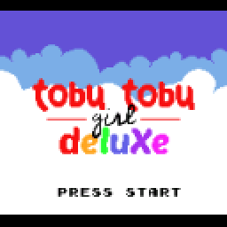

# CGB-Bit: Game Boy and Game Boy Color on the CircuitMess Bit

[](https://github.com/dkorunic/CGB-Bit/actions/workflows/build.yml)

Standalone ESP-IDF firmware that turns a CircuitMess Bit (all revisions; Bit 3.0 = hardware
revision 3/4, read from efuse) into a **Game Boy and Game Boy Color**, using the
[Walnut-CGB](https://github.com/Mr-PauI/Walnut-CGB) emulator: Mr. Paul's performance-oriented
fork of [Peanut-GB](https://github.com/deltabeard/Peanut-GB) with Game Boy Color support. It comes
with [Tobu Tobu Girl Deluxe](roms/README.md), a free homebrew game, and plays your own `.gb` and
`.gbc` files.

**[Install from your browser](https://dkorunic.github.io/CGB-Bit/)**: desktop Chrome, Edge or
Opera and a USB-C cable, nothing to install. The same page flashes your own games.



What the Bit's 128x128 screen shows, at 2x size and 20 FPS: rendered on the PC by
`tools/make_demo.sh` through the firmware's own emulator setup and scaler. `tools/demo.cpp` presses
through the menus, then an autopilot plays the first level for 20 seconds.

## What you get

- **Games**: original Game Boy and Game Boy Color games, Color-only ones included, on
  cartridges with no mapper, MBC1, MBC2, MBC3 (with its clock) or MBC5.
- **Picture**: the 160x144 screen scaled to 128x115 with an exact 5:4 box filter per colour
  channel (each screen pixel blends two Game Boy pixels per axis), centred. Game Boy Color games
  show their own colours; original Game Boy games get the colours a Game Boy Color gives them:
  its palette for that title for Nintendo-published games (Tetris, Super Mario Land, Pokémon...),
  its default (white, green, navy) for all others.
- **Speed**: real Game Boy speed, 59.73 frames per second, on Walnut-CGB's dual-fetch CPU core.
  The emulator has one of the ESP32-S3's two cores; the scaling runs on the other. Its hot
  helpers run from internal RAM, and in a scene too heavy for full speed it draws only every other
  frame, so the game itself keeps its speed.
- **Sound**: the two square-wave channels, tracked from the game's register writes (frequency,
  trigger, length, volume envelope, master volume), with the loudest one played on the buzzer.
  Melodies and many effects come through; the wave and noise channels (bass, drums) and the sweep
  effect don't.
- **Saves**: battery-backed cartridge RAM (high scores, save games) is kept in flash, stored a
  second after the game stops writing it and before any sleep or shutdown, alternately into two
  slots so a power cut while storing keeps the previous save. Each save is tied to its game.
  An MBC3 game's clock is kept with its save, so it carries on from there at the next power-on.
  Cartridges without a battery lose their RAM at power-off, as on a Game Boy.
- **Resume**: auto-sleep and the low-battery shutdown store the whole running game; switching the
  Bit back on carries on from that moment, once. Switching off with the power switch cuts power at
  once, so the game starts afresh next time (with its battery save). A firmware update starts
  games afresh too, and a resume never goes back past a newer battery save.
- From [Anarch-Bit](https://github.com/dkorunic/Anarch-Bit): auto-sleep after 2 minutes
  without input (the screen dims 10 s before), low-battery icon below 15% and shutdown at 1%,
  backlight fades, battery monitoring as in the stock firmware.

## Controls

| Bit | Game Boy |
|---|---|
| D-pad | D-pad |
| A | A |
| B | B |
| Menu, short press | Start |
| Menu, held half a second | Select (while held) |

## Flash a prebuilt release

The easiest way is the [browser installer](https://dkorunic.github.io/CGB-Bit/) (ESP Web Tools,
built on Espressif's esptool-js). It flashes the latest release with Tobu Tobu Girl Deluxe,
replacing the game on the Bit. It asks "Erase device" first: leave it unticked to keep the save,
which lives in its own partition that no install writes; each game only loads its own.

Every `v*` tag also gets a [release](https://github.com/dkorunic/CGB-Bit/releases) with two files
built by CI:

- `cgb-bit-merged.bin`: everything, Tobu Tobu Girl Deluxe included, written at `0x0`.
- `cgb-bit.bin`: the emulator alone, written at `0x10000`, to update it and keep the game. Coming
  from v0.1.0, install once with the browser installer or the merged image instead: resume needs
  the newer partition table (without it the game just doesn't resume).

With [esptool](https://docs.espressif.com/projects/esptool/) (`pip install esptool`) and the Bit
connected over USB:

```shell
esptool.py --chip esp32s3 -p /dev/ttyACM0 write_flash 0x0 cgb-bit-merged.bin   # first install
esptool.py --chip esp32s3 -p /dev/ttyACM0 write_flash 0x10000 cgb-bit.bin      # update
```

The port is `COMx` on Windows and `/dev/cu.usbmodem...` on macOS.

## Your own game

Game Boy and Game Boy Color games (`.gb`, `.gbc`, up to 4 MB) go into the `rom` flash partition at
`0x110000`, over the bundled one.

In the [browser installer](https://dkorunic.github.io/CGB-Bit/), "Your own game": pick the file
(and, if you like, an `.ips` or `.bps` patch for it: a translation, bug fix or hack, applied in the
page; a BPS patch made for another version of the game is refused) and the page checks it the way the firmware will (Game Boy header and checksum, a supported
cartridge type, size) and shows its title, then flashes it with "Replace the game only" (CGB-Bit
already on the Bit) or "Install CGB-Bit with this game". The file goes from the page to the Bit; it
isn't uploaded anywhere. Don't tick "Erase device" with "Replace the game only": that erases
CGB-Bit too, and the Bit needs one of the install buttons again.

With esptool:

```shell
esptool.py --chip esp32s3 -p /dev/ttyACM0 write_flash 0x110000 game.gbc
```

When building from source, `idf.py -DGB_ROM=game.gbc flash` does the same (a relative path is
taken from the project directory). The firmware reads a game up to the ROM size its header
declares, so a file shorter than that must be padded with 0xFF bytes to it: the browser installer
does it, the build refuses such a file, and esptool writes it as it is.

A game only ever loads its own save. The Bit has room for one game's save: once a different game
has saved twice, the previous game's save is gone.

Use games you're allowed to: homebrew (the [Homebrew Hub](https://hh.gbdev.io/) lists many free
ones) or dumps of cartridges you own.

## Build from source

Needs ESP-IDF 5.x (tested to build with v5.4.1) and `patch`. LovyanGFX 1.2.36 is fetched from git
automatically by the IDF component manager.

```shell
git clone --recursive https://github.com/dkorunic/CGB-Bit.git   # or: git submodule update --init
cd CGB-Bit
. ~/esp/esp-idf/export.sh
idf.py build
idf.py -p /dev/ttyACM0 flash monitor
```

`idf.py flash` writes the emulator and the game (`roms/tobudx.gb`, or `-DGB_ROM=...`) and keeps
the save partition. `idf.py monitor` prints
`CPU load: N% (scaler on core 1: M%), F frames shown, S skipped` every second: the first core's
time (emulation, sending frames) as a share of the Game Boy's frame time, which must stay under
100% for full speed, then the second core's (scaling), then how many of the 60 frames were shown
and how many were skipped to keep up (the others not shown: the game turned its screen off).

- `walnut-cgb/`: git submodule, [Mr-PauI/Walnut-CGB](https://github.com/Mr-PauI/Walnut-CGB),
  left untouched. The build copies `walnut_cgb.h` into `build/` and applies `patches/*.diff`:
  cartridge RAM fixes for MBC2 and MBC5+RUMBLE games (upstream PRs
  [#7](https://github.com/Mr-PauI/Walnut-CGB/pull/7) and
  [#8](https://github.com/Mr-PauI/Walnut-CGB/pull/8); drop each once merged). CGB-Bit runs it
  with its dual-fetch core (`gb_run_frame_dualfetch`) and 16- and 32-bit ROM reads that fall back
  to bytes when unaligned, as memory-mapped flash requires.
- `main/frontend.h`: the scaler, the sound tracker, the Menu button, the save and resume formats
  and the original-game palettes, with no ESP-IDF dependencies, so the PC tools use the same code.
- `main/cgb_palettes.h`: the Game Boy Color boot ROM's palette tables, generated from SameBoy.

## Development

PC tools, needing a C++20 compiler, `patch` and (for the GIF) Python with Pillow and gifsicle,
but not ESP-IDF. Run them from a normal shell: the ESP-IDF shell's Python has no Pillow.

- `tools/smoke_test.sh [game.gbc]`: checks the scaler (including the firmware's two-core split),
  the sound tracker, saves, the patched MBC2/rumble cartridge RAM, the original-game palettes and
  the Menu button, then plays a minute of the game (default: Tobu Tobu Girl Deluxe, in Game Boy
  Color mode) under ASan/UBSan and checks a save state resumes into exactly the same game.
- `tools/make_demo.sh`: regenerates `demo.gif`. The run is scripted in frames for Tobu Tobu Girl
  Deluxe, with an autopilot for the level that reads the emulated sprites, so it comes out the
  same every time.
- `web/build.sh <dir> <cgb-bit-merged.bin> <version>`: assembles the browser installer site: the
  firmware (the merged image cut at the `rom` partition) and the bundled game as separate parts,
  so the page can put a player's game in the bundled one's place. It fails if the merged image
  doesn't hold the bundled game at `web/manifest.json`'s offset, so the two can't drift apart.
- `web/gb.js`: the page's ROM checks and install manifests; `node --test web/gb.test.mjs` tests
  them against the bundled game and broken variants of it.

CI (`.github/workflows/build.yml`) runs the smoke test and the `web/gb.js` test on every push and
pull request, then builds the firmware in the `espressif/idf:v5.4.1` image; on `v*` tags it
attaches both images to a release and deploys the browser installer to GitHub Pages. That needs
Pages set to "GitHub Actions" and the `github-pages` environment to allow `v*` tags (by default it
only allows the default branch):

```shell
gh api -X POST repos/dkorunic/CGB-Bit/pages -f build_type=workflow
gh api -X POST repos/dkorunic/CGB-Bit/environments/github-pages/deployment-branch-policies -f name='v*' -f type=tag
```

## Not supported

- Choosing another palette for an original Game Boy game (a Game Boy Color's button combinations
  at boot).
- Link cable. MBC3 clocks stand still while the Bit is off (it has no clock of its own that
  survives the power switch), and a clock cartridge without RAM (type 0x0F) has no save to keep
  its clock in, so it starts at day 0 at every power-on.
- Games with 128 KB of cartridge RAM may not find room for it in RAM; they stop with a message.

## License

[CC0 1.0](LICENSE) (public domain) for everything in this repository except third-party parts,
which keep their own licenses: Walnut-CGB (submodule, MIT, derived from Peanut-GB, MIT, with parts
from SameBoy, MIT), the Game Boy Color palette tables in `main/cgb_palettes.h` (generated from
SameBoy's `BootROMs/cgb_boot.asm`, Expat/MIT, Copyright (c) 2015-2026 Lior Halphon), Tobu Tobu
Girl Deluxe (`roms/tobudx.gb`: code MIT, assets CC BY 4.0, see [roms/README.md](roms/README.md)),
LovyanGFX (fetched at build time, FreeBSD license).
